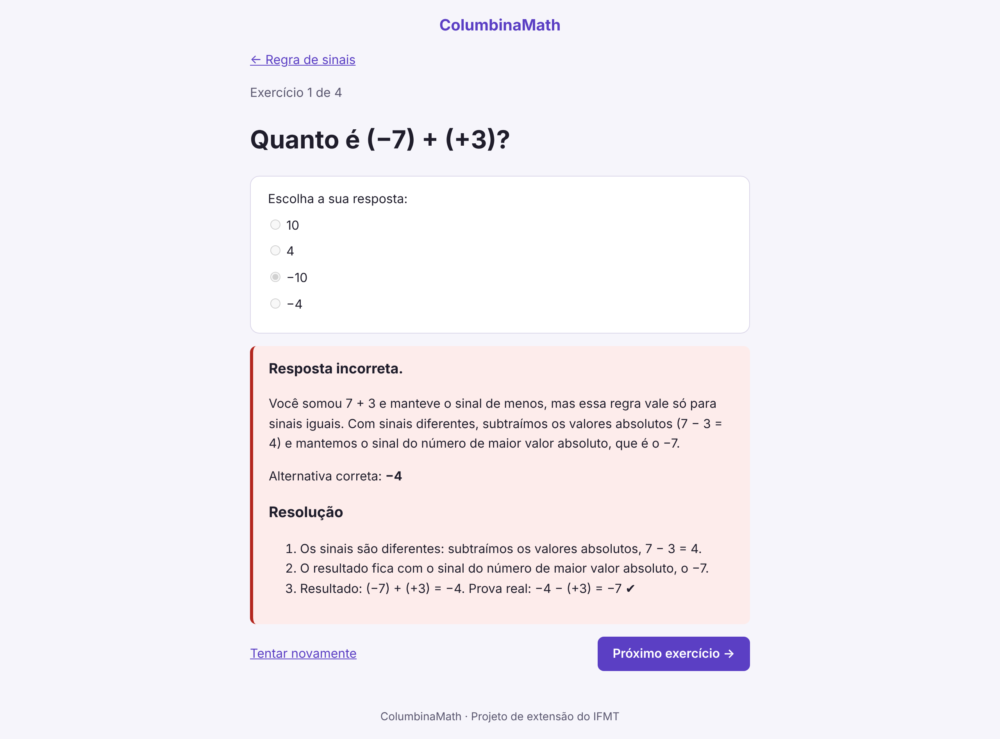

# ColumbinaMath

[](https://github.com/th1agopaes/columbinamath/actions/workflows/ci.yml)

Aplicação web para estudantes do Ensino Médio revisarem matemática básica, com explicações, exemplos resolvidos e exercícios com **feedback por erro comum**: cada alternativa errada explica o raciocínio que levou até ela.



## Funcionalidades

Por perfil de usuário:

| Perfil | O que faz |
|---|---|
| Visitante | Consulta a trilha e as explicações com exemplos resolvidos. |
| Aluno | Cria conta, resolve exercícios com feedback por erro comum, continua de onde parou, acompanha o próprio progresso e entra em turmas com o código de acesso. |
| Professor | Cria turmas, passa o código aos alunos e acompanha o desempenho da turma e de cada aluno. |
| Administrador | Cadastra conteúdos, exercícios e erros comuns e cria as contas de professor, pelo painel do Django. |

Também:

- Trilha de conteúdos na ordem de pré-requisitos, começando por Operações básicas e Regra de sinais.
- Exercícios de múltipla escolha corrigidos no servidor, com a resolução passo a passo.
- Cada resposta vira uma tentativa registrada, base do progresso e do desempenho da turma.
- Modo claro e escuro, no computador e no celular.

## Modelagem do sistema

O código implementa os quatro casos de uso da modelagem feita em Programação Web:

| Caso de uso | Onde está no sistema |
|---|---|
| UC1 - Resolver Exercício | Página do exercício (app `conteudos`), com a tentativa registrada no app `progresso` |
| UC2 - Acompanhar Progresso | Página "Meu progresso" (app `progresso`) |
| UC3 - Cadastrar Exercício | Painel administrativo, em `/admin` |
| UC4 - Acompanhar Desempenho da Turma | Página "Turmas" (app `turmas`) |

- [Modelagem - Parte I](docs/requisitos/modelagem/modelagem-parte-1.pdf): cenário, documento de visão, modelo conceitual e casos de uso descritivos.
- [Modelagem - Parte II](docs/requisitos/modelagem/modelagem-parte-2.pdf): diagramas de sequência e diagrama de classes.
- [Casos de uso atualizados](docs/requisitos/especificacao-casos-de-uso.md), com as diferenças em relação à modelagem.
- [Matriz de rastreabilidade](docs/requisitos/matriz-rastreabilidade.md): requisito, caso de uso, história, issue e teste.

## Tecnologias

| Área | Ferramenta |
|---|---|
| Linguagem e framework | Python 3.14 e Django 6.1 (padrão MVT) |
| Interface | Templates do Django e CSS próprio, renderizados no servidor (pasta [`frontend/`](frontend/)) |
| API REST | Django REST Framework (somente leitura, em JSON) |
| Dependências | uv |
| Testes | pytest, pytest-django e pytest-cov (cobertura mínima de 90% no CI) |
| Qualidade | Ruff e pre-commit (Conventional Commits e detecção de segredos com gitleaks) |
| Banco de dados (desenvolvimento) | SQLite |

## Como executar localmente

Pré-requisitos: [Git](https://git-scm.com/) e [uv](https://docs.astral.sh/uv/).

```bash
git clone https://github.com/th1agopaes/columbinamath.git
cd columbinamath/backend
uv sync
cp .env.example .env
```

Gere uma chave secreta e cole-a no `SECRET_KEY` do arquivo `.env`:

```bash
uv run python -c "import secrets; print(secrets.token_urlsafe(50))"
```

Crie o banco, carregue os conteúdos e inicie o servidor:

```bash
uv run python manage.py migrate
uv run python manage.py loaddata conteudos regra_de_sinais
uv run python manage.py runserver
```

Acesse <http://127.0.0.1:8000> e crie uma conta de aluno em "Criar conta".

### Contas de administrador e de professor

Crie o administrador (o terminal pede e-mail, nome de usuário e senha):

```bash
uv run python manage.py createsuperuser
```

Para criar um professor, entre no painel em <http://127.0.0.1:8000/admin>, abra **Usuários → Adicionar usuário**, preencha os dados e escolha o tipo **Professor**. Depois, entre no site com o e-mail e a senha do professor e use a página "Turmas".

## API REST

A API é somente leitura e responde em JSON. No navegador, o Django REST Framework mostra uma interface navegável.

| Método e endereço | O que devolve |
|---|---|
| `GET /api/` | Os recursos disponíveis |
| `GET /api/conteudos/` | A trilha, na ordem de estudo, com o total de exercícios |
| `GET /api/conteudos/<slug>/` | Um conteúdo, com a introdução e a lista de exercícios |
| `GET /api/exercicios/` | Os exercícios; aceita o filtro `?conteudo=<slug>` |
| `GET /api/exercicios/<id>/` | Um exercício com as alternativas, **sem** dizer qual é a correta |

Exemplo, com o servidor rodando:

```bash
curl http://127.0.0.1:8000/api/exercicios/1/
```

```json
{"id": 1, "conteudo": "operacoes-basicas", "enunciado": "Quanto é 247 + 185?", "nivel": "facil", "alternativas": ["322", "332", "422", "432"]}
```

A correção continua no servidor, pela página do exercício, para a resposta correta não chegar ao navegador antes da resposta do aluno.

## Testes e qualidade

```bash
uv run pytest --cov
```

Os hooks de qualidade rodam a cada commit. Para ativá-los:

```bash
uv tool install pre-commit
pre-commit install
```

Os mesmos hooks e os testes com cobertura rodam no GitHub Actions a cada Pull Request e a cada mudança na `main`.

## Estrutura

```text
columbinamath/
├── backend/          # projeto Django: regras de negócio e dados
│   ├── config/       # configurações e rotas principais
│   ├── api/          # API REST somente leitura (RF010)
│   ├── conteudos/    # trilha, explicações, exercícios e correção (UC1 e UC3)
│   ├── progresso/    # tentativas e progresso do aluno (UC1 e UC2)
│   ├── turmas/       # turmas e desempenho da turma (UC4)
│   ├── usuarios/     # usuário, perfis (aluno e professor), cadastro e login
│   └── conftest.py   # dados de teste compartilhados
├── frontend/         # camada de apresentação: templates HTML e CSS
└── docs/             # produto, Scrum, requisitos, UML e arquitetura
```

## Processo de desenvolvimento

- **Scrum:** backlog e sprints em [`docs/scrum/`](docs/scrum/), com o quadro no [GitHub Projects](https://github.com/users/th1agopaes/projects/2).
- **GitHub Flow:** cada mudança nasce de uma issue, é feita numa branch e entra na `main` por Pull Request.
- **Conventional Commits:** mensagens de commit padronizadas e verificadas pelo pre-commit.
- **Integração contínua:** o [GitHub Actions](.github/workflows/ci.yml) roda os hooks e os testes com cobertura em cada Pull Request, e o Dependabot propõe as atualizações de dependências.
- **ADRs:** decisões de arquitetura registradas em [`docs/arquitetura/adr/`](docs/arquitetura/adr/).

## Documentação

- [Visão do produto](docs/produto/visao.md)
- [Requisitos](docs/requisitos/requisitos.md)
- [Casos de uso](docs/requisitos/especificacao-casos-de-uso.md)
- [Matriz de rastreabilidade](docs/requisitos/matriz-rastreabilidade.md)
- [Product Backlog](docs/scrum/product-backlog.md)
- [Sprint 2](docs/scrum/sprints/sprint-02.md)
- [Sprint 3](docs/scrum/sprints/sprint-03.md)
- [ADR 0001: troca da stack para Django](docs/arquitetura/adr/0001-troca-de-stack-para-django.md)
- [ADR 0002: camada de apresentação na pasta frontend](docs/arquitetura/adr/0002-camada-de-apresentacao-na-pasta-frontend.md)
- [ADR 0003: perfis de usuário em tabela única com modelos proxy](docs/arquitetura/adr/0003-perfis-de-usuario-em-tabela-unica.md)

## Contexto acadêmico

Projeto do 5º semestre de Engenharia da Computação do IFMT, Campus Cuiabá, usado em três disciplinas:

- **Programação Web:** projeto individual.
- **Engenharia de Software** e **Extensão I:** projeto em dupla.

A primeira versão (Sprint 1, em React) está no repositório [columbinamath-v1](https://github.com/th1agopaes/columbinamath-v1).

## Autores

- **Thiago Paes de Barros Costa** ([github.com/th1agopaes](https://github.com/th1agopaes)): gestão do projeto, requisitos, modelagem, arquitetura e desenvolvimento.
- **Mônica Diglianne Paes de Barros Costa:** validação do produto, demonstração de uso e elaboração das questões e respostas (Engenharia de Software e Extensão I).
