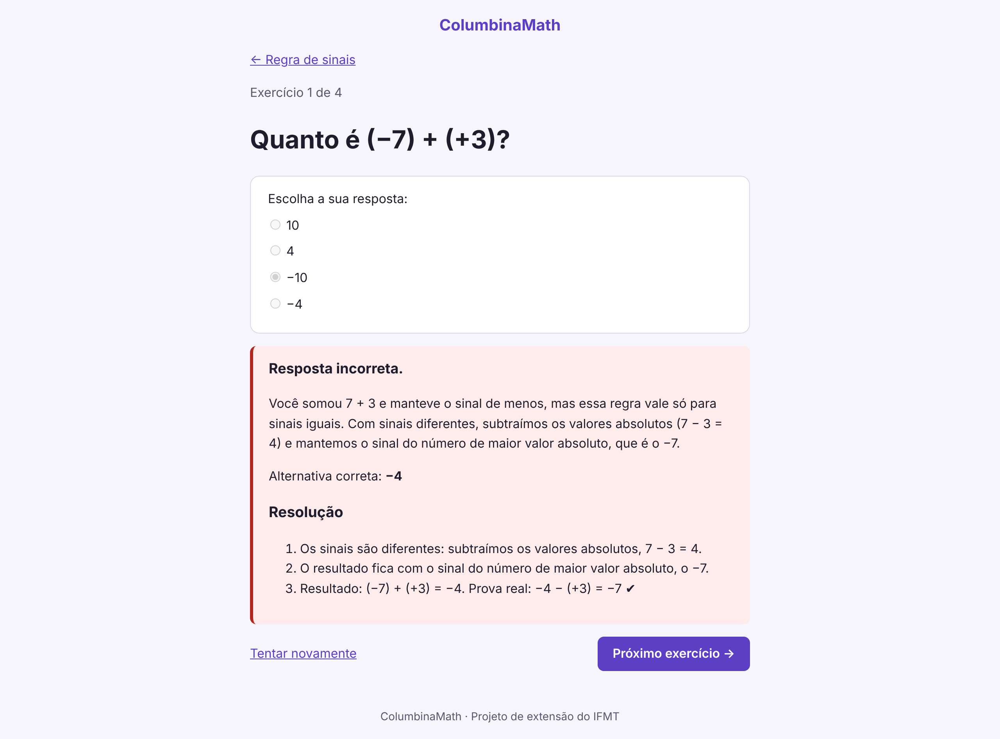

# ColumbinaMath

Aplicação web para estudantes do Ensino Médio revisarem matemática básica, com explicações, exemplos resolvidos e exercícios com **feedback por erro comum**: cada alternativa errada explica o raciocínio que levou até ela.



## Funcionalidades

- Trilha de conteúdos na ordem de pré-requisitos, começando por Operações básicas e Regra de sinais.
- Explicação de cada conteúdo com exemplos resolvidos passo a passo.
- Exercícios de múltipla escolha corrigidos no servidor, com feedback por erro comum e resolução explicada.
- Painel administrativo para cadastrar conteúdos, exercícios e erros comuns.
- Modo claro e escuro, no computador e no celular.

## Tecnologias

| Área | Ferramenta |
|---|---|
| Linguagem e framework | Python 3.14 e Django 6.1 |
| Dependências | uv |
| Testes | pytest e pytest-django |
| Qualidade | Ruff e pre-commit (Conventional Commits e detecção de segredos com gitleaks) |
| Banco de dados (desenvolvimento) | SQLite |

## Como executar localmente

Pré-requisitos: [Git](https://git-scm.com/) e [uv](https://docs.astral.sh/uv/).

```bash
git clone https://github.com/th1agopaes/columbinamath.git
cd columbinamath/backend
uv sync
cp .env.example .env
```

Gere uma chave secreta e cole-a no `SECRET_KEY` do arquivo `.env`:

```bash
uv run python -c "import secrets; print(secrets.token_urlsafe(50))"
```

Crie o banco, carregue os conteúdos e inicie o servidor:

```bash
uv run python manage.py migrate
uv run python manage.py loaddata conteudos regra_de_sinais
uv run python manage.py runserver
```

Acesse <http://127.0.0.1:8000>. Para usar o painel administrativo em `/admin`, crie um usuário com `uv run python manage.py createsuperuser`.

## Testes e qualidade

```bash
uv run pytest
```

Os hooks de qualidade rodam a cada commit. Para ativá-los:

```bash
uv tool install pre-commit
pre-commit install
```

## Estrutura

```text
columbinamath/
├── backend/          # projeto Django
│   ├── config/       # configurações e rotas principais
│   ├── conteudos/    # trilha, explicações, exercícios e correção
│   ├── usuarios/     # modelo de usuário (aluno, professor e administrador)
│   ├── templates/    # layout base das páginas
│   └── static/       # estilos (CSS)
└── docs/             # produto, Scrum, requisitos, UML e arquitetura
```

## Processo de desenvolvimento

- **Scrum:** backlog e sprints em [`docs/scrum/`](docs/scrum/), com o quadro no [GitHub Projects](https://github.com/users/th1agopaes/projects/2).
- **GitHub Flow:** cada mudança nasce de uma issue, é feita numa branch e entra na `main` por Pull Request.
- **Conventional Commits:** mensagens de commit padronizadas e verificadas pelo pre-commit.
- **ADRs:** decisões de arquitetura registradas em [`docs/arquitetura/adr/`](docs/arquitetura/adr/).

## Documentação

- [Visão do produto](docs/produto/visao.md)
- [Product Backlog](docs/scrum/product-backlog.md)
- [Sprint 2](docs/scrum/sprints/sprint-02.md)
- [ADR 0001: troca da stack para Django](docs/arquitetura/adr/0001-troca-de-stack-para-django.md)

## Contexto acadêmico

Projeto individual do 5º semestre de Engenharia da Computação do IFMT, Campus Cuiabá, usado nas disciplinas de Engenharia de Software, Programação Web e Extensão I.

A primeira versão (Sprint 1, em React) está no repositório [columbinamath-v1](https://github.com/th1agopaes/columbinamath-v1).

## Autor

Thiago Paes ([github.com/th1agopaes](https://github.com/th1agopaes))
