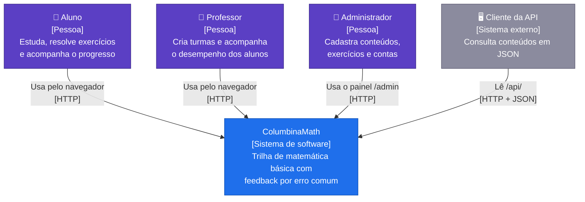
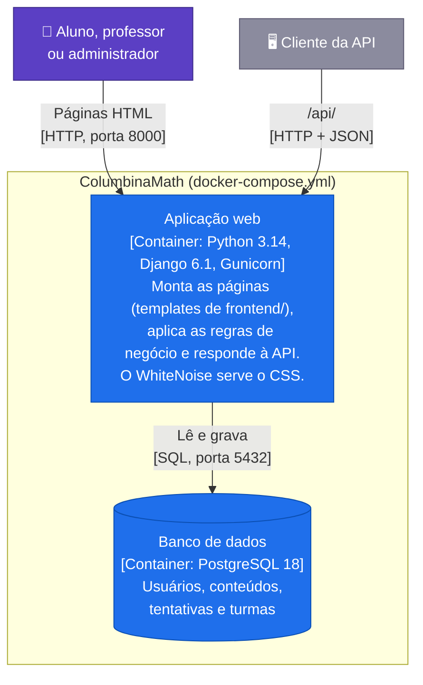
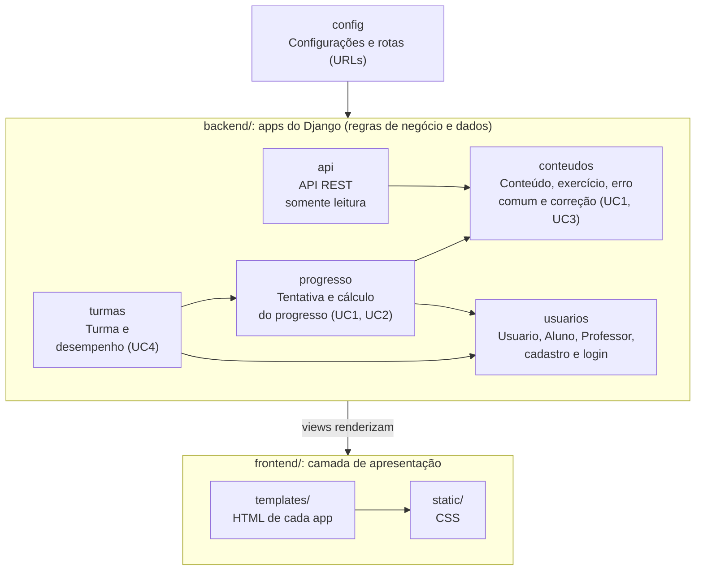
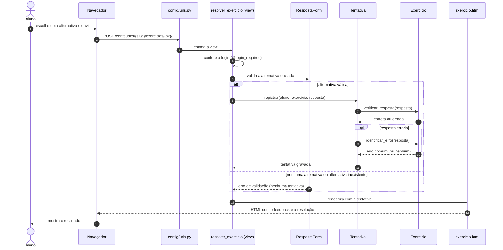
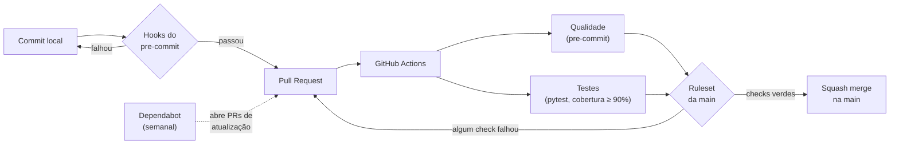

# Arquitetura do ColumbinaMath

O ColumbinaMath é uma aplicação **cliente-servidor**: o navegador pede uma página e o servidor devolve o HTML pronto (renderização no servidor). O servidor é um **monólito modular** em Django, organizado em camadas pelo padrão MVT (Model, View, Template) e dividido em apps por assunto.

Os diagramas seguem o [modelo C4](https://c4model.com/), que descreve um sistema em níveis de zoom: contexto, containers e componentes. As decisões que levaram a esta arquitetura estão nos [ADRs](#decisões-de-arquitetura).

## Nível 1: contexto

Quem usa o sistema e com o que ele se comunica.

## Nível 2: containers

As partes que rodam separadamente. Na execução por containers ([ADR 0004](adr/0004-postgresql-e-containers.md)), são dois: a aplicação e o banco de dados.

No desenvolvimento local, a aplicação roda com o `runserver` do Django e o banco é um arquivo SQLite. O mesmo código usa o PostgreSQL quando a variável `POSTGRES_HOST` está definida.

## Nível 3: componentes da aplicação web

Os apps do Django e a camada de apresentação. Cada seta indica "depende de": por exemplo, a `Tentativa` (app `progresso`) aponta para o `Exercicio` (app `conteudos`) e para o aluno (app `usuarios`).

Para não poluir o diagrama, ficam de fora duas dependências menores: a view do exercício (app `conteudos`) registra a `Tentativa` (app `progresso`), e os métodos `Aluno.calcular_progresso()` e `Aluno.entrar_turma()` importam `progresso` e `turmas` dentro do próprio método, para evitar a importação circular com `usuarios`.

## Camadas do padrão MVT

| Camada | Responsabilidade | Onde fica |
|---|---|---|
| URL | Liga cada endereço a uma view | `backend/config/urls.py` e `urls.py` de cada app |
| View | Recebe a requisição, confere login e perfil, chama o modelo e escolhe o template | `views.py` de cada app |
| Model | Dados e regras de negócio (correção, progresso, código de turma) | `models.py` de cada app e `progresso/calculos.py` |
| Template | HTML que o usuário vê | `frontend/templates/` ([ADR 0002](adr/0002-camada-de-apresentacao-na-pasta-frontend.md)) |

As regras de negócio ficam nos modelos, e não nas views. Assim, a página e a API usam a mesma regra (por exemplo, `Exercicio.alternativas()`), e os testes conferem a regra sem precisar de uma requisição HTTP.

## Fluxo de uma requisição: responder a um exercício (UC1)

## Integração contínua

Cada mudança passa por verificações automáticas antes de entrar na `main`.

- **Hooks do pre-commit:** formatação e lint com o Ruff, detecção de segredos com o gitleaks, padrão Conventional Commits e bloqueio de commits diretos na `main`.
- **GitHub Actions:** roda os mesmos hooks e os testes com cobertura mínima de 90% em cada Pull Request e em cada mudança na `main`.
- **Ruleset "Proteger a main":** exige Pull Request e os dois checks verdes, e impede reescrever o histórico.

## Stack tecnológico

| Área | Tecnologia | Por que foi escolhida |
|---|---|---|
| Linguagem e framework | Python 3.14 e Django 6.1 | Conteúdo de Programação Web; traz ORM, autenticação, formulários e painel administrativo prontos ([ADR 0001](adr/0001-troca-de-stack-para-django.md)) |
| Interface | Templates do Django e CSS próprio | Renderização no servidor, sem uma segunda stack; modo claro e escuro e layout responsivo ([ADR 0002](adr/0002-camada-de-apresentacao-na-pasta-frontend.md)) |
| API REST | Django REST Framework | Padrão de mercado para APIs em Django; interface navegável para demonstração |
| Banco de dados | SQLite no desenvolvimento e PostgreSQL em containers | Desenvolvimento sem instalação; banco robusto na execução completa ([ADR 0004](adr/0004-postgresql-e-containers.md)) |
| Execução | Gunicorn, WhiteNoise, Podman ou Docker | Servidor de produção, arquivos estáticos sem servidor extra e execução com um comando |
| Dependências | uv | Instalação rápida e reprodutível pelo `uv.lock` |
| Qualidade | Ruff, pre-commit, pytest e pytest-cov | Lint, formatação e testes automáticos em cada commit e em cada Pull Request |
| CI e manutenção | GitHub Actions, Dependabot e ruleset | Verificação automática e atualização segura das dependências |

## Decisões de arquitetura

| ADR | Decisão |
|---|---|
| [0001](adr/0001-troca-de-stack-para-django.md) | Trocar a stack Node/React por Python/Django |
| [0002](adr/0002-camada-de-apresentacao-na-pasta-frontend.md) | Separar a camada de apresentação na pasta `frontend/` |
| [0003](adr/0003-perfis-de-usuario-em-tabela-unica.md) | Representar os perfis de usuário em uma tabela única, com modelos proxy |
| [0004](adr/0004-postgresql-e-containers.md) | Executar em containers, com PostgreSQL, Gunicorn e WhiteNoise |
