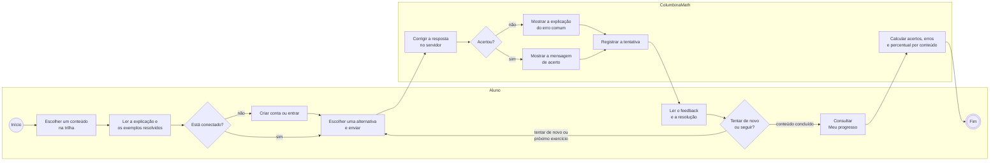
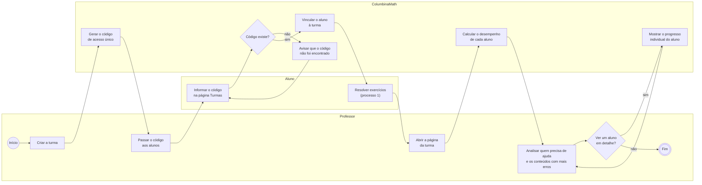

# Processos de negócio (BPD) - ColumbinaMath

Os diagramas de processo de negócio (BPD, *Business Process Diagram*) mostram, passo a passo, como o trabalho acontece entre as pessoas e o sistema. Cada raia é um participante; o processo começa no evento de início (círculo) e termina no evento de fim (círculo duplo).

O Mermaid não tem a notação BPMN completa. Os diagramas usam um fluxograma com as mesmas convenções: raias, eventos de início e fim, tarefas e decisões (losangos).

## Processo 1: estudar um conteúdo e praticar

Processo principal do produto (UC1 e UC2): o aluno estuda, responde e acompanha o próprio progresso.

## Processo 2: acompanhar uma turma

Processo do professor (UC4): ele cria a turma, os alunos entram com o código, e ele acompanha o desempenho.

## Relação com os casos de uso

| Processo | Casos de uso | Requisitos |
|---|---|---|
| 1. Estudar um conteúdo e praticar | UC1 - Resolver Exercício e UC2 - Acompanhar Progresso | RF001, RF005, RF006 e RF009 |
| 2. Acompanhar uma turma | UC4 - Acompanhar Desempenho da Turma | RF007 e RF008 |
