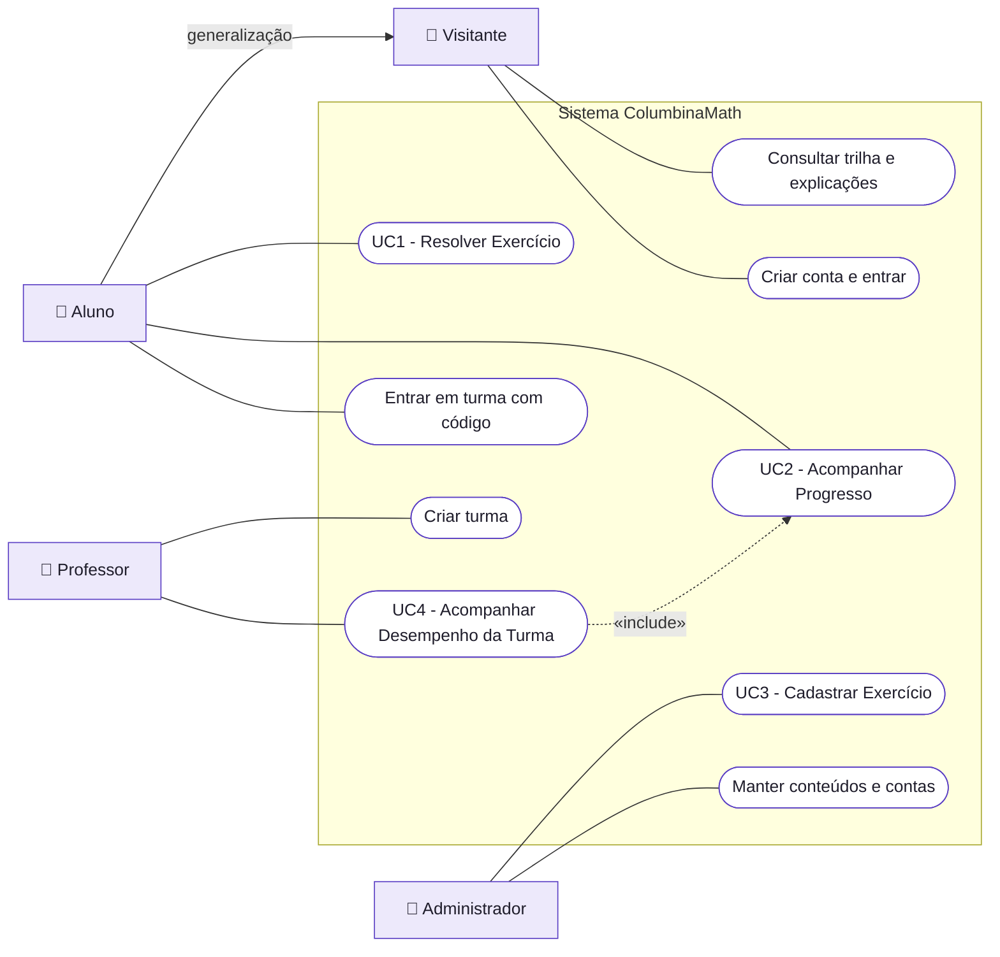

# Diagrama de casos de uso - ColumbinaMath

O diagrama mostra quem usa o ColumbinaMath (atores) e o que cada um faz no sistema (casos de uso). Os quatro casos de uso descritivos, UC1 a UC4, estão detalhados na [especificação dos casos de uso](../requisitos/especificacao-casos-de-uso.md).

## Como ler

- **Atores** (👤) ficam fora do sistema; **casos de uso** (elipses) ficam dentro do retângulo "Sistema ColumbinaMath".
- **Linha contínua:** o ator executa o caso de uso.
- **Generalização:** o aluno também é um visitante, então pode fazer tudo o que o visitante faz.
- **«include»:** o UC4 usa o UC2 para mostrar o progresso individual de um aluno da turma.

O Mermaid não tem a notação de casos de uso da UML. O diagrama usa um fluxograma com as mesmas convenções: atores, elipses, fronteira do sistema e o relacionamento «include».

## Rastreabilidade

| Caso de uso | Ator | Requisitos | Histórias | Onde está |
|---|---|---|---|---|
| Consultar trilha e explicações | Visitante | RF009 | US01, US02, US04 | Trilha e página do conteúdo |
| Criar conta e entrar | Visitante | RF001 | US07 | `/conta/cadastro/` e `/conta/entrar/` |
| UC1 - Resolver Exercício | Aluno | RF005 | US03, US08 | Página do exercício |
| UC2 - Acompanhar Progresso | Aluno | RF006 | US09 | "Meu progresso" |
| Entrar em turma com código | Aluno | RF007 | US10 | "Turmas" |
| Criar turma | Professor | RF007 | US10 | "Turmas" |
| UC4 - Acompanhar Desempenho da Turma | Professor | RF008 | US11 | Página da turma |
| UC3 - Cadastrar Exercício | Administrador | RF003, RF004 | - | Painel em `/admin` |
| Manter conteúdos e contas | Administrador | RF001, RF002 | - | Painel em `/admin` |
