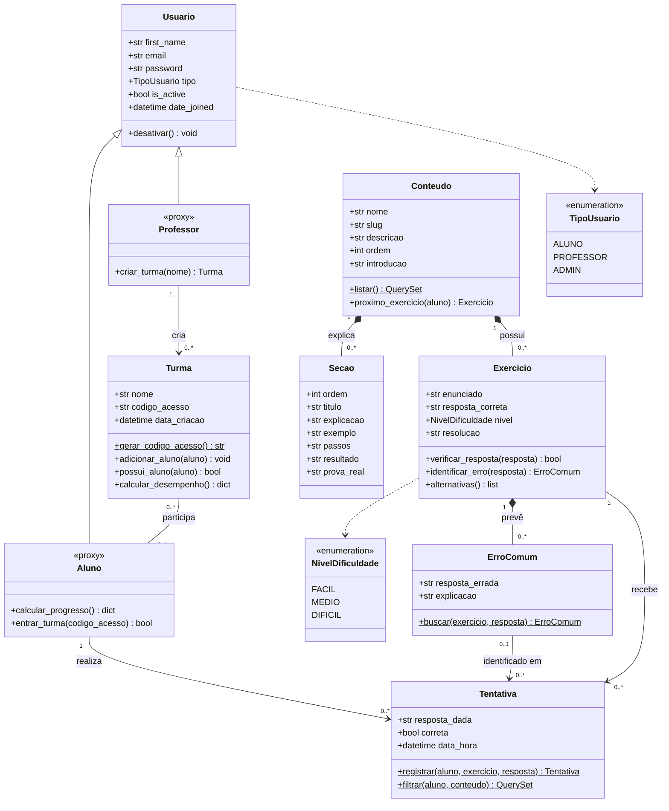
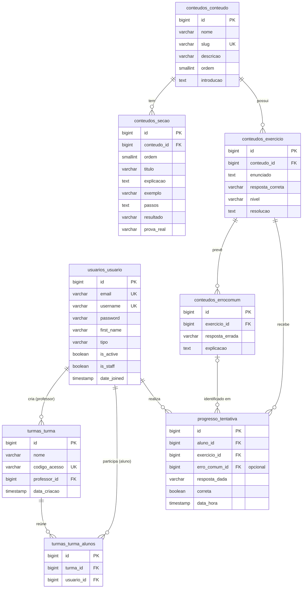

# Diagrama de classes e modelo de dados - ColumbinaMath

Este documento mostra o modelo do sistema como ele foi implementado: o diagrama de classes (visão orientada a objetos) e o DER (visão do banco de dados). O diagrama de classes da modelagem original está na [Modelagem - Parte II](../requisitos/modelagem/modelagem-parte-2.pdf).

## Diagrama de classes

### Como ler

- **Herança** (seta com triângulo): `Aluno` e `Professor` são tipos de `Usuario`.
- **Composição** (losango cheio): a parte não existe sem o todo. Ao excluir um conteúdo, seus exercícios e seções também são excluídos.
- **Associação** (seta simples) com multiplicidade: um aluno realiza de 0 a muitas tentativas (`0..*`); uma tentativa errada pode ter um erro comum (`0..1`).
- **Métodos sublinhados** (marcados com `$`) são de classe: funcionam sem um objeto, como `Turma.gerar_codigo_acesso()`.

### Diferenças em relação à Modelagem - Parte II

| Modelagem | Implementação | Por quê |
|---|---|---|
| `Aluno`, `Professor` e `Administrador` como subclasses | `Aluno` e `Professor` são modelos proxy da mesma tabela; `Administrador` é um valor de `tipo` | [ADR 0003](../arquitetura/adr/0003-perfis-de-usuario-em-tabela-unica.md) |
| `Usuario.nome`, `senha`, `ativo`, `data_cadastro` | `first_name`, `password` (com hash), `is_active` e `date_joined`, herdados do `AbstractUser` do Django | Recursos prontos e seguros do framework (RNF002) |
| `Usuario.autenticar(email, senha)` | Login do Django com o e-mail como identificador (`USERNAME_FIELD`) | Mesma regra, sem reimplementar a autenticação |
| `Aluno.serie` | Não implementado | Dado pessoal desnecessário (RNF003, LGPD) |
| `Conteudo.proximo_exercicio(aluno)` | Primeiro exercício que o aluno ainda não acertou | Botão "Continuar de onde parei" |
| - | `Secao`, `Exercicio.resolucao` e `Exercicio.alternativas()` | Explicação com exemplos resolvidos e exercícios de múltipla escolha |
| - | `Tentativa.registrar()` | Corrige a resposta e grava a tentativa num só lugar |

## Modelo de dados (DER)

As tabelas abaixo são as criadas pelas migrações do Django, no SQLite e no PostgreSQL. As tabelas internas do Django (sessões, permissões e grupos) foram omitidas.

### Regras do banco

- `usuarios_usuario.email`, `conteudos_conteudo.slug` e `turmas_turma.codigo_acesso` são únicos.
- Um exercício não pode ter dois erros comuns com a mesma resposta errada (restrição única em `exercicio_id` e `resposta_errada`).
- Excluir um conteúdo exclui suas seções e exercícios; excluir um exercício exclui seus erros comuns e tentativas (`CASCADE`).
- Excluir um erro comum mantém as tentativas, com `erro_comum_id` vazio (`SET NULL`), para não apagar o histórico do aluno.
- O progresso e o desempenho não têm tabela: são calculados a partir de `progresso_tentativa`.
